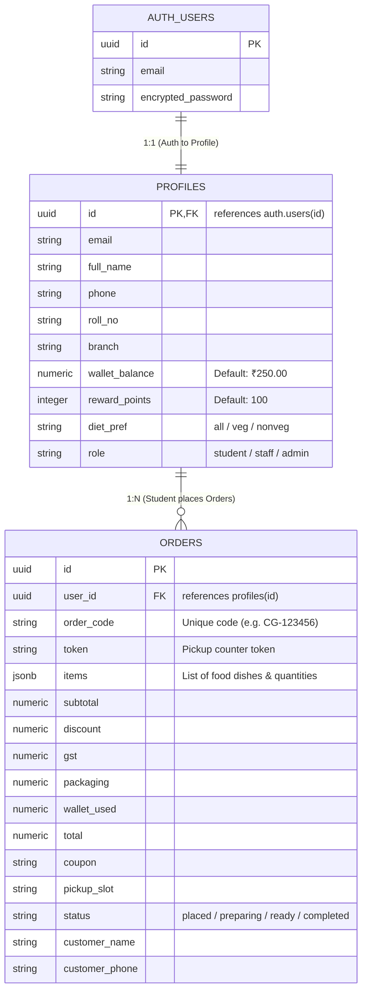

# Supabase Multi-Table Architecture · CampusBite

Your database is structured with **two separate tables** connected together:

1. **Table 1: `public.profiles` (User Logins & Accounts)**
   Stores student account details, roll numbers, campus wallet balance, and reward points.
2. **Table 2: `public.orders` (Canteen Orders)**
   Stores all food orders placed by students, item lists, tokens, pickup slots, and status.

---

## Architecture Overview



---

## 1. Table 1: `public.profiles` (Login & Users)

To create the `profiles` table:
1. Open the [Supabase SQL Editor](https://supabase.com/dashboard/project/yydlpwulcpuamowzpcbj/sql/new).
2. Copy and run [supabase/profiles-table.sql](file:///c:/Users/rajam/smart-canteen/supabase/profiles-table.sql).

### Automatic Features:
* **Auto-creation Trigger:** Whenever someone signs up with email & password, Supabase automatically creates a record in `profiles` with an initial ₹250 wallet balance and 100 reward points.
* **Auto-Backfill:** Existing users (`student@campusbite.com`, `admin@campusbite.app`) are automatically migrated into `profiles`.
* **Row-Level Security (RLS):** Students can only read and update their own profile.

---

## 2. Table 2: `public.orders` (Orders Table)

Stores placed orders linked to the student by `user_id`:
* Already active in your database!
* **RLS Policies:** Students can insert their own orders and read their past orders.

---

## 3. Test & Query Both Tables from Terminal

```powershell
# 1. Test both tables and auth:
node scripts/supabase-service.js test

# 2. View Table 1: profiles (User Logins & Accounts):
node scripts/supabase-service.js profiles

# 3. View Table 2: orders (All Canteen Orders):
node scripts/supabase-service.js orders

# 4. Run client login, profile query & order insert:
node scripts/test-client.js
```
